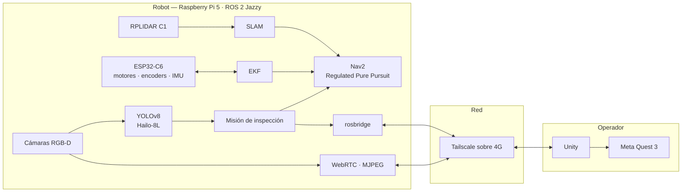

# Plague-Bot VR

**Robot agrícola autónomo para la detección temprana de plagas en invernaderos de tomate,
con teleoperación en realidad virtual.**

🥇 **First Prize — Huawei ICT Competition 2025–2026, final global** (Shenzhen, junio 2026) ·
🏆 **Global Award Winner — Intel AI Global Impact Festival 2026** ·
📄 *Edge-AI and 6-DOF Robotic Manipulator for Greenhouse Crop Monitoring*, aceptado en **COMRob 2026**

> **English summary.** Plague-Bot VR is an autonomous agricultural robot for early pest
> detection in tomato greenhouses, built by JADA Robotics (Universidad Iberoamericana, Mexico
> City). It navigates greenhouse corridors on its own (ROS 2 Jazzy, Nav2, SLAM), detects pests
> with edge AI (YOLOv8 on Hailo-8L) and streams video and data to an operator in virtual reality
> (Unity + Meta Quest 3) over Tailscale/4G, with 40–60 ms teleoperation latency measured over 4G.
> Field-validated in a 20-hectare commercial greenhouse in Oaxaca, Mexico.
> *This is a showcase repository: the source code is private.*

---

## El problema

El monitoreo de plagas en invernaderos se hace caminando surco por surco y revisando las
plantas a ojo. Es lento, y cuando una plaga se detecta tarde ya se extendió. Plague-Bot VR
recorre los pasillos de forma autónoma, inspecciona las plantas con cámaras y un modelo de
visión que corre en el propio robot, y le manda al operador video y detecciones para que
supervise o tome el control desde un visor de realidad virtual.

El sistema se validó en campo en un **invernadero comercial de 20 ha en Oaxaca**.

## Arquitectura

## Tecnologías

- **Robótica:** ROS 2 Jazzy, Nav2 (Regulated Pure Pursuit), `slam_toolbox`, `robot_localization`
  (EKF), `ros2_control`, MoveIt 2, Gazebo Harmonic.
- **Edge AI:** YOLOv8 en Raspberry Pi 5 con acelerador Hailo-8L.
- **Transmisión y red:** WebRTC (aiortc), MJPEG, rosbridge, Tailscale sobre 4G.
- **Realidad virtual:** Unity con Meta XR SDK en Meta Quest 3.
- **Hardware:** Raspberry Pi 5, ESP32-C6, RPLIDAR C1, Intel RealSense D435, brazo de 6 GDL.

## Resultados medidos

| Métrica | Valor | Condiciones |
|---|---|---|
| Latencia de teleoperación | **40–60 ms** | Robot real, enlace 4G con Tailscale |

## Videos

Canal de JADA Robotics: https://www.youtube.com/@JADAROBOTICS

| Video | Link |
|---|---|
| Simulación del brazo de 6 GDL (MoveIt 2 + RViz + Gazebo) | https://youtu.be/uLlgKZa18GU |
| Demo 2 | https://youtu.be/fUsj6qzUkL8 |
| Demo 3 | https://youtu.be/VieNlwHURlk |
| Demo 4 | https://youtu.be/AoGdSpipxuY |
| Demo 5 | https://youtu.be/ixA1cEQ-LvA |
| Short 1 | https://youtube.com/shorts/mvpq_sJYgL8 |
| Short 2 | https://youtube.com/shorts/UekEfUiRmN4 |
| Short 3 | https://youtube.com/shorts/Rlnfhgqy3jQ |

## Equipo — JADA Robotics, Universidad Iberoamericana CDMX

| Integrante | Rol |
|---|---|
| **Orlando Camacho** | Capitán y líder técnico. Navegación autónoma (ROS 2, Nav2, SLAM, Gazebo), pipeline de teleoperación (WebRTC sobre Tailscale, 40–60 ms en 4G), HUD de realidad virtual en Unity para Meta Quest 3, chasis del robot e integración del sistema. |
| **Eliot Calderón** | Detección de plagas con IA: visión por computadora y edge AI (YOLOv8, Hailo-8L), entrenamiento y dataset. |
| **Adán López** | Brazo robótico PROTÓN de 6 GDL: electrónica y diseño. |
| **Mtro. Joel Arango Ramírez** | Asesor. |

## Código fuente

El código de Plague-Bot VR es privado. Para consultarlo, contacta a Orlando Camacho a través
de su perfil de GitHub ([@orlandocamc](https://github.com/orlandocamc)).

---

© 2026 Orlando Camacho. All rights reserved.
